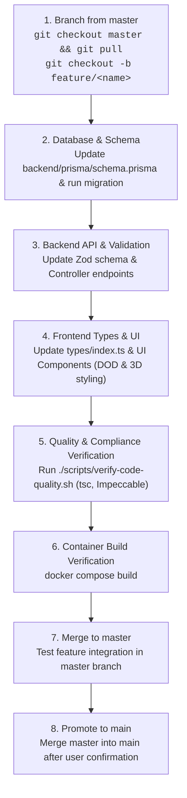

# TechFSD Platform Parity Specification & Change Roadmap

## 1. Context & Purpose

This document serves as the official reference guide and execution manual for aligning the **Unified Affiliate Platform** with the live reference site [panel.techfsd.com](https://panel.techfsd.com). 

Whenever a change, field addition, or new screen is required, follow this specification to ensure 100% field parity while **strictly preserving existing UI layouts, styling, and functionality**.

---

## 2. Core Operating Principles

1. **Zero UI Disruption**: Never remove or break existing fields, cards, or styling. Any newly added fields from `panel.techfsd.com` must be integrated as optional controls, secondary sub-sections, or collapsible accordions.
2. **Visual Consistency (DOD & Impeccable)**:
   - High-contrast typography across Dark Mode and Light Mode.
   - 3D tactile buttons, subtle top-edge bevel highlights, and smooth gradients.
   - Table-first parameter views (no messy badge clouds).
   - 1-click token copying with instant visual feedback.
3. **Data Integrity & Safe Fallback**: Missing or invalid partner parameters must safely fallback to the master account so traffic and revenue are never lost.
4. **Git Branching Workflow**:
   - `main`: Protected production backup branch containing verified stable running code.
   - `master`: Active working and integration branch.
   - `feature/<module-name>`: Created off `master` for each individual module enhancement. Once tested and containerized, merged into `master`, and promoted to `main` upon final confirmation.

---

## 3. Module-by-Module Field Specification & Gap Analysis

```
panel.techfsd.com (Reference)                  Current Codebase (affliate-lite)
├── Dashboard                                   ├── DashboardView.tsx
├── Domains (/domain/add, /domains)             ├── DomainsView.tsx
├── Networks (/network/add, /networks)          ├── NetworksView.tsx
├── Offers (/offer/add, /offers, /edit/:id)    ├── OffersView.tsx & OfferBuilder.tsx
├── Publishers (/publisher/add, /publishers)    ├── PublishersView.tsx
├── Reports (Networks, Offers, Publishers...)   ├── ReportsView.tsx
├── Logs (Clicks, Conversions, Sessions)        └── (Candidate for new Views)
└── Payouts (/payouts)                          └── (Candidate for new Views)
```

---

### Module 1: Offers (`/offers`, `/offer/add`, `/offer/edit/:id`)

#### A. Add / Edit Offer Form Fields

| Field Name | Reference Input Type | Description / Options | Status in Current UI | Implementation Target |
| :--- | :--- | :--- | :--- | :--- |
| **Name** | Text (`offer_name`) | Campaign title | ✅ Implemented | General Tab |
| **Description** | Textarea (`offer_description`) | Instructions, KPIs, off-limits traffic | ✅ Implemented | General Tab |
| **Category** | Dropdown (`offer_category_id`) | E-commerce, Nutra, Finance, Crypto, etc. | ❌ Missing | General Tab (Select with create option) |
| **Blocked Traffic Types** | Multi-select (`offer_traffic_types_exclude[]`) | Contextual, Display, Search, Social, Native, Mobile Ads, Email, Incentive | ❌ Missing | General Tab (Pill toggle group) |
| **Domain** | Dropdown (`offer_domain_id`) | Tracking domain assignment | ✅ Implemented | Tracking Tab |
| **Network (Advertiser)** | Dropdown (`offer_network_id`) | Advertiser attribution | ✅ Implemented | General Tab |
| **Visibility** | Dropdown (`offer_visibility`) | `Public`, `Private`, `Requires Approval` | ✅ Implemented | General Tab |
| **Publishers** | Multi-select (`offer_publishers[]`) | Dual-list (All Affiliates vs Enabled Affiliates) | ✅ Implemented | Affiliates Tab |
| **Countries** | Multi-select (`offer_countries[]`) | Multi-select ISO country list (`ALL` or specific) | ✅ Implemented | Targeting Tab |
| **Blocked US States** | Multi-select (`offer_states_exclude[]`) | US state code exclusion: AL, AK, AZ, CA, TX, NY... | ❌ Missing | Targeting Tab (US States exclusion picker) |
| **Device Routing** | Mode (`all` vs `specific`) | Universal URL, or dedicated Desktop, Android, iOS URLs | ⚠️ Partial | Tracking Tab (Add direct OS URL inputs) |
| **Redirect Interstitial** | Dropdown (`offer_redirect`) | `Direct`, `Via Facebook`, `Via Google`, `Via Youtube` | ❌ Missing | Tracking Tab (Interstitial routing dropdown) |
| **Referrer Policy** | Dropdown (`offer_referrer`) | `Hide` (no referrer sent) vs `Show` (sends tracking domain) | ❌ Missing | Tracking Tab (Referrer header toggle) |
| **Revenue & Payout** | Fixed vs Revshare (`%`), Currency, Amount | Fixed payout or % Revshare from advertiser postback | ✅ Implemented | Revenue & Payouts Tab |
| **Lock Revenue** | Checkbox (`offer_revenue_lock`) | Keeps entered revenue fixed even if advertiser postback passes different `p=` | ❌ Missing | Revenue & Payouts Tab (Switch toggle) |
| **Proxy / Fraud Filter** | Switch (`offer_proxy`) | Rejects clicks identified as VPN, proxy, or low-trust | ❌ Missing | Tracking Tab (Fraud filter toggle) |
| **Duplicate IP Rule** | Checkbox (`offer_duplicate`) | Scoped to this offer or network-wide | ✅ Implemented | Tracking Tab |
| **Scheduling & Dayparting** | Date/Time pickers + Weekday selectors | Timezone, Days of week, Hours (Whole, 9-5, Custom), Start date, Expiry date | ❌ Missing | Targeting Tab (Collapsible "Dayparting & Schedule" card) |
| **Caps Sub-Module** | Number inputs | Daily conversions cap, Total conversions cap, Daily click cap, Total click cap | ❌ Missing | New "Caps" Card / Sub-section |
| **Custom Publisher Payouts** | Overrides table | Custom payout/revshare for individual publishers | ❌ Missing | Affiliates / Revenue Tab |

#### B. Offers Manage Table Columns (`/offers`)
- `#` (ID with version badge `v1`, `v2`)
- `Name` (with subtitle pills for devices and countries)
- `Domain`
- `Network`
- `Clicks`
- `Conversions`
- `Cap` *(Missing: Show `current / max` with "Cap Hit" alert badge)*
- `Status` (`Active`, `Paused`, `Disabled`)
- `Added` (Formatted timestamp)
- `Actions`: Edit, Copy Tracking Link, Duplicate, Toggle Status, Delete

---

### Module 2: Publishers / Affiliates (`/publishers`, `/publisher/add`)

#### A. Add / Edit Publisher Form Fields

| Field Name | Reference Input Type | Description / Options | Status in Current UI | Implementation Target |
| :--- | :--- | :--- | :--- | :--- |
| **Name** | Text (`publisher_name`) | Publisher full name | ✅ Implemented | Add/Edit Modal |
| **Email** | Email (`publisher_email`) | Unique login email | ✅ Implemented | Add/Edit Modal |
| **Password** | Password (`publisher_password`) | Login password (min 8 chars) | ✅ Implemented | Add/Edit Modal |
| **Publisher Type** | Select (`publisher_type`) | `Publisher` vs `SubPublisher` | ✅ Implemented | Add/Edit Modal |
| **Assigned Offers** | Multi-select (`publisher_offers[]`) | Multi-select offer picker with search | ✅ Implemented | Add/Edit Modal |
| **Timezone** | Dropdown (`publisher_timezone_id`) | Account timezone (e.g. UTC, Asia/Karachi, etc.) | ❌ Missing | Add/Edit Modal (Optional dropdown) |
| **Payout Mode** | Dropdown (`publisher_payout_type`) | `Offer` (uses offer defaults) vs `Fixed` (custom fixed amount) | ❌ Missing | Add/Edit Modal |
| **Link Mode** | Dropdown (`publisher_link_mode`) | `Inherit`, `Choose Offers`, `Rotate` (auto-rotates to least-clicked offer) | ❌ Missing | Add/Edit Modal |
| **Postback URL** | Textarea (`publisher_postback`) | S2S callback with 1-click token chips | ✅ Implemented | Add/Edit Modal |
| **Welcome Email** | Checkbox (`publisher_welcome_email`) | "Email the sign-in link and password to this publisher" | ❌ Missing | Add Modal |
| **Payable Policy** | Dropdowns (in Edit modal) | Override policy for rejected & unchecked conversions | ❌ Missing | Edit Modal (Payable Policy section) |

#### B. Publishers Manage Table Columns (`/publishers`)
- `#` (ID)
- `Name` (with email subtitle)
- `Offers` *(Add: Count badge of assigned offers)*
- `Status` (`Active`, `Inactive`, `Paused`)
- `Added` (Formatted date)
- `Actions`: Edit, Login as Publisher, Toggle Status, Delete

---

### Module 3: Networks / Advertisers (`/networks`, `/network/add`)

#### A. Add / Edit Network Form Fields

| Field Name | Reference Input Type | Description / Options | Status in Current UI | Implementation Target |
| :--- | :--- | :--- | :--- | :--- |
| **Name** | Text (`network_name`) | Advertiser company name | ✅ Implemented | Add/Edit Panel |
| **Contact Details** | Text (`contact_details`) | Telegram handle, Skype ID, or Email | ✅ Implemented | Add/Edit Panel |
| **Software** | Dropdown (`network_software_id`) | Custom, Everflow, Lead Byte, Affise, etc. | ❌ Missing | Add/Edit Panel (Optional dropdown) |
| **Tracking Template** | Text (`network_tracking`) | Advertiser click URL with `{click_id}`, `{gclid}`, `{fbclid}` | ❌ Missing | Add/Edit Panel (Tracking template box) |
| **Postback Click Param** | Text (`network_postback`) | Parameter key for click ID on advertiser postback (e.g. `c=`, `clickid=`) | ❌ Missing | Add/Edit Panel |
| **Postback Revenue Param** | Text (`network_postback_revenue`) | Parameter key for revenue amount on postback (e.g. `p=`, `amount=`) | ❌ Missing | Add/Edit Panel |
| **Duplicate Scope** | Checkbox (`network_duplicate`) | On: Scoped to single offer; Off: Blocked network-wide | ✅ Implemented | Add/Edit Panel |

#### B. Networks Manage Table Columns (`/networks`)
- `#` (ID)
- `Name`
- `Offers` *(Add: Active offers count badge)*
- `Last Conversion` *(Add: Timestamp of latest conversion from this network)*
- `Duplicates` (`Restricted` / `Allowed`)
- `Status` (`Active` / `Inactive`)
- `Added`
- `Actions`: Edit, Toggle Status, Delete

---

### Module 4: Domains (`/domains`, `/domain/add`)

#### A. Add Domain Form Fields
- **Domain Name**: FQDN (e.g. `trk.myoffer.live`).

#### B. Domains Manage Table Columns (`/domains`)
- `#` (ID)
- `Name`
- `Offers` *(Add: Count badge of active campaigns using this domain)*
- `Health` *(Add: SSL / DNS verification badge: "Active", "Propagating", "Unverified")*
- `Status` (`Active` / `Inactive`)
- `Added`
- `Actions`: Toggle Status, Delete

---

### Module 5: Advanced Reports (`/report/*`)

In `panel.techfsd.com`, reports display a multi-tiered breakdown for audit-proof verification:

#### A. Dedicated Sub-Report Views
1. **Offers Report** (`/report/offers`)
2. **Publishers Report** (`/report/publishers`)
3. **Networks Report** (`/report/networks`)
4. **Countries Report** (`/report/countries`)
5. **Devices Report** (`/report/devices`)
6. **Dates Report** (`/report/dates`)

#### B. Grouped Multi-Tier Metric Columns
- **Clicks Group**: `Clean` (Approved), `Flagged` (Fraud/Proxy/Duplicate), `Not Checked`, `Total`.
- **Conversions Group**: `Clean` (Approved), `Flagged` (Declined), `Not Checked`, `Total`.
- **Financials**: `Payout` ($ / PKR), `Revenue` ($ / PKR), `Profit` (Revenue - Payout), `CR` (Conversion Rate %).
- **Status**: `Active`, `Paused`, `Disabled`, or `Cap Hit`.
- **Export Capabilities**: 1-Click Excel / CSV Export and Formatted Print view.

---

### Module 6: Real-Time Event Logs (New Candidate Views)

`panel.techfsd.com` provides real-time audit logs for operational transparency:

1. **Click Logs (`/log/clicks`)**:
   - Columns: `#` (Click ID), `Offer`, `Domain`, `Network`, `Publisher`, `Geolocation` (Country flag, City, IP), `Device` (OS, Browser, Device Type), `Status` (Clean/Flagged), `Added`.
2. **Conversion Logs (`/log/conversions`)**:
   - Columns: `#` (Conversion ID), `Offer`, `Revenue`, `Payout`, `Publisher`, `Geolocation`, `Device`, `Status` (Approved, Declined, Unchecked), `Payable` (Payable / Non-payable), `Converted` (Timestamp), `Click to Conversion` (Latency delta: e.g. `3m 14s`).
3. **Session Logs (`/log/sessions`)**: Inbound traffic sessions.
4. **User Agent Logs (`/log/useragents`)**: Breakdown of user agents and click share.

---

## 4. Step-by-Step Change Process Recipe

When tasked with implementing any of the missing fields or features:



### Step 1: Branch Creation
Always branch off `master`:
```bash
git checkout master
git pull origin master
git checkout -b feature/<feature-name>
```

### Step 2: Database Schema
1. Add new optional fields to `backend/prisma/schema.prisma` with sensible defaults so existing records remain valid.
2. Run Prisma migration / db push:
```bash
npx prisma db push --schema backend/prisma/schema.prisma
```

### Step 3: Backend API & Zod Gates
1. Update `backend/src/schemas/` to accept new optional fields in Zod schemas.
2. Update the corresponding controller in `backend/src/controllers/`.

### Step 4: Frontend Types & Components
1. Update TypeScript interfaces in [frontend/src/types/index.ts](file:///Users/tk-lpt-1088/projects/react/affliate/frontend/src/types/index.ts).
2. Integrate controls into the respective view adhering to:
   - Modern 3D gradient theme (`theme-dark.min.css` / high-contrast CSS variables).
   - Zero hardcoding standard (extract tokens & options).
   - Unconditional React hooks (declare all hooks at top level).

### Step 5: Verification (Mandatory Pre-Commit Checks)
Run the automated verification script:
```bash
./scripts/verify-code-quality.sh
```
Ensure:
- 0 TypeScript compiler errors (`tsc --noEmit`).
- 0 Git merge conflicts.
- 0 Impeccable UI/UX anti-patterns (`node .agents/skills/impeccable/scripts/detect.mjs`).

### Step 6: Container Build
Test container build to ensure no Dockerfile or bundle breaks:
```bash
npm run build
```

### Step 7: Push & Promotion
1. Commit and push the feature branch:
```bash
git push -u origin feature/<feature-name>
```
2. Merge into `master` for testing.
3. Once confirmed working, merge `master` into `main` as the verified stable backup.
