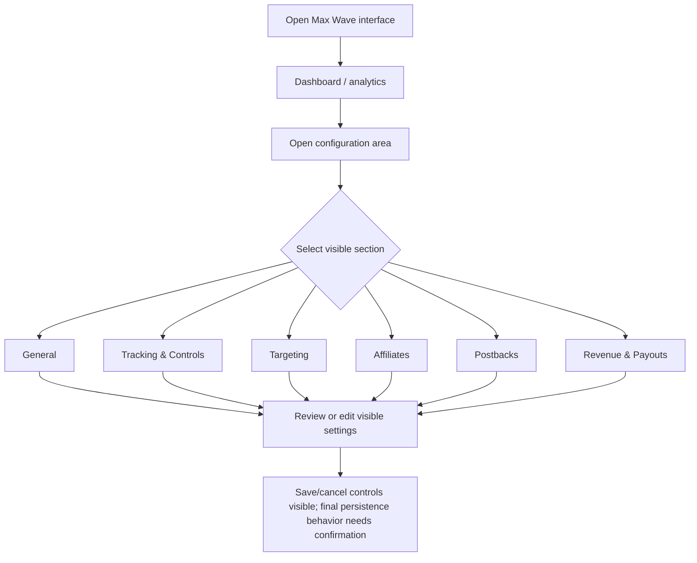

# Max Wave — Screen-by-Screen Software Requirements Specification

## 1. Evidence and scope

Source recording: `Max Wave & Oval Media.mov` (duration 00:08:48).
Application identification: Max Wave is identified from the visible application branding/interface during the walkthrough; the recording alternates between application contexts.
Evidence status: **video-observed** means visible in a sampled frame; it does not prove backend persistence or the result of an action. **Proposed** means a requirement for client approval, not a statement about the existing system.

## 2. Executive summary

The recording shows a dark, purple-accented interface with an analytics/dashboard view and configuration sections. The business purpose of each setting, formulas, and downstream effects require client confirmation.

## 3. Observed module inventory

- Dashboard / analytics
- General
- Tracking & Controls
- Targeting
- Affiliates
- Postbacks
- Revenue & Payouts

## 4. Screen inventory

| Screenshot ID | Screen / module | Timestamp | Evidence notes |
|---|---|---:|---|
| `MW-001_Dashboard` | Dashboard | 00:00:21 | Dark interface with purple header/navigation and summary cards. |
| `MW-002_Dashboard_Analytics` | Dashboard / Analytics | 00:01:39 | Analytics dashboard with KPI cards and chart area. |
| `MW-003_Configuration_Table` | Configuration / Table | 00:01:36 | Dense tabular configuration view; exact table labels require close review. |
| `MW-004_General_Settings` | Settings / General | 00:03:42 | General settings page with internal section navigation. |
| `MW-005_Tracking_Controls` | Tracking & Controls | 00:04:30 | Tracking controls page with settings panels and right-side information area. |
| `MW-006_Targeting` | Targeting | 00:05:03 | Targeting configuration form with multiple selectors and controls. |
| `MW-007_Affiliates` | Affiliates | 00:05:18 | Affiliate configuration view with two main panels and row actions. |
| `MW-008_Postbacks` | Postbacks | 00:05:54 | Postback integration configuration with input fields and explanatory side panel. |
| `MW-009_Revenue_Payouts` | Revenue & Payouts | 00:07:00 | Revenue/payout configuration form. |

## 5. Screen specifications

### MW-001_Dashboard — Dashboard

- **Application:** Max Wave
- **Module:** Dashboard
- **Screenshot:** `Screenshots/MW-001_Dashboard.png`
- **Source timestamp:** 00:00:21
- **Evidence status:** Observed frame; behavior partly observed / unresolved where noted.
- **Visible purpose:** Dark interface with purple header/navigation and summary cards.
- **Entry/navigation:** The recording shows this page/state. Exact click path and role gate are not fully established unless explicitly demonstrated.
- **Layout:** Preserve the visible header, navigation, page title, form/table arrangement, action controls and styling shown in the screenshot. Labels that are too small to read are not guessed.
- **UI controls:** Visible buttons, fields, navigation entries, tables and row actions should be inventoried during client-assisted field-level validation. This frame-level package does not claim every tiny label is legible.
- **Field specification:** Field names, types, required flags, defaults, validation and allowed values are **unconfirmed** unless separately documented by the client.
- **States/exceptions:** Only the sampled visible state is confirmed. Empty, loading, error, success, disabled and permission-denied states require additional evidence/tests.
- **Business rules/data model:** Not inferred from screen appearance. Obtain data dictionary, formulas and entity relationships from the client.
- **Acceptance criteria:** Given an authorized user and the approved requirements, when the user opens this page, then the page and its visible controls should render consistently with the approved screenshot. Action-specific criteria must be added after action outcomes are confirmed.
- **Open questions:** What exact fields/actions are present? What are required validations? What does each action do? What is persisted and where? Which roles can access the screen?

### MW-002_Dashboard_Analytics — Dashboard / Analytics

- **Application:** Max Wave
- **Module:** Dashboard / Analytics
- **Screenshot:** `Screenshots/MW-002_Dashboard_Analytics.png`
- **Source timestamp:** 00:01:39
- **Evidence status:** Observed frame; behavior partly observed / unresolved where noted.
- **Visible purpose:** Analytics dashboard with KPI cards and chart area.
- **Entry/navigation:** The recording shows this page/state. Exact click path and role gate are not fully established unless explicitly demonstrated.
- **Layout:** Preserve the visible header, navigation, page title, form/table arrangement, action controls and styling shown in the screenshot. Labels that are too small to read are not guessed.
- **UI controls:** Visible buttons, fields, navigation entries, tables and row actions should be inventoried during client-assisted field-level validation. This frame-level package does not claim every tiny label is legible.
- **Field specification:** Field names, types, required flags, defaults, validation and allowed values are **unconfirmed** unless separately documented by the client.
- **States/exceptions:** Only the sampled visible state is confirmed. Empty, loading, error, success, disabled and permission-denied states require additional evidence/tests.
- **Business rules/data model:** Not inferred from screen appearance. Obtain data dictionary, formulas and entity relationships from the client.
- **Acceptance criteria:** Given an authorized user and the approved requirements, when the user opens this page, then the page and its visible controls should render consistently with the approved screenshot. Action-specific criteria must be added after action outcomes are confirmed.
- **Open questions:** What exact fields/actions are present? What are required validations? What does each action do? What is persisted and where? Which roles can access the screen?

### MW-003_Configuration_Table — Configuration / Table

- **Application:** Max Wave
- **Module:** Configuration / Table
- **Screenshot:** `Screenshots/MW-003_Configuration_Table.png`
- **Source timestamp:** 00:01:36
- **Evidence status:** Observed frame; behavior partly observed / unresolved where noted.
- **Visible purpose:** Dense tabular configuration view; exact table labels require close review.
- **Entry/navigation:** The recording shows this page/state. Exact click path and role gate are not fully established unless explicitly demonstrated.
- **Layout:** Preserve the visible header, navigation, page title, form/table arrangement, action controls and styling shown in the screenshot. Labels that are too small to read are not guessed.
- **UI controls:** Visible buttons, fields, navigation entries, tables and row actions should be inventoried during client-assisted field-level validation. This frame-level package does not claim every tiny label is legible.
- **Field specification:** Field names, types, required flags, defaults, validation and allowed values are **unconfirmed** unless separately documented by the client.
- **States/exceptions:** Only the sampled visible state is confirmed. Empty, loading, error, success, disabled and permission-denied states require additional evidence/tests.
- **Business rules/data model:** Not inferred from screen appearance. Obtain data dictionary, formulas and entity relationships from the client.
- **Acceptance criteria:** Given an authorized user and the approved requirements, when the user opens this page, then the page and its visible controls should render consistently with the approved screenshot. Action-specific criteria must be added after action outcomes are confirmed.
- **Open questions:** What exact fields/actions are present? What are required validations? What does each action do? What is persisted and where? Which roles can access the screen?

### MW-004_General_Settings — Settings / General

- **Application:** Max Wave
- **Module:** Settings / General
- **Screenshot:** `Screenshots/MW-004_General_Settings.png`
- **Source timestamp:** 00:03:42
- **Evidence status:** Observed frame; behavior partly observed / unresolved where noted.
- **Visible purpose:** General settings page with internal section navigation.
- **Entry/navigation:** The recording shows this page/state. Exact click path and role gate are not fully established unless explicitly demonstrated.
- **Layout:** Preserve the visible header, navigation, page title, form/table arrangement, action controls and styling shown in the screenshot. Labels that are too small to read are not guessed.
- **UI controls:** Visible buttons, fields, navigation entries, tables and row actions should be inventoried during client-assisted field-level validation. This frame-level package does not claim every tiny label is legible.
- **Field specification:** Field names, types, required flags, defaults, validation and allowed values are **unconfirmed** unless separately documented by the client.
- **States/exceptions:** Only the sampled visible state is confirmed. Empty, loading, error, success, disabled and permission-denied states require additional evidence/tests.
- **Business rules/data model:** Not inferred from screen appearance. Obtain data dictionary, formulas and entity relationships from the client.
- **Acceptance criteria:** Given an authorized user and the approved requirements, when the user opens this page, then the page and its visible controls should render consistently with the approved screenshot. Action-specific criteria must be added after action outcomes are confirmed.
- **Open questions:** What exact fields/actions are present? What are required validations? What does each action do? What is persisted and where? Which roles can access the screen?

### MW-005_Tracking_Controls — Tracking & Controls

- **Application:** Max Wave
- **Module:** Tracking & Controls
- **Screenshot:** `Screenshots/MW-005_Tracking_Controls.png`
- **Source timestamp:** 00:04:30
- **Evidence status:** Observed frame; behavior partly observed / unresolved where noted.
- **Visible purpose:** Tracking controls page with settings panels and right-side information area.
- **Entry/navigation:** The recording shows this page/state. Exact click path and role gate are not fully established unless explicitly demonstrated.
- **Layout:** Preserve the visible header, navigation, page title, form/table arrangement, action controls and styling shown in the screenshot. Labels that are too small to read are not guessed.
- **UI controls:** Visible buttons, fields, navigation entries, tables and row actions should be inventoried during client-assisted field-level validation. This frame-level package does not claim every tiny label is legible.
- **Field specification:** Field names, types, required flags, defaults, validation and allowed values are **unconfirmed** unless separately documented by the client.
- **States/exceptions:** Only the sampled visible state is confirmed. Empty, loading, error, success, disabled and permission-denied states require additional evidence/tests.
- **Business rules/data model:** Not inferred from screen appearance. Obtain data dictionary, formulas and entity relationships from the client.
- **Acceptance criteria:** Given an authorized user and the approved requirements, when the user opens this page, then the page and its visible controls should render consistently with the approved screenshot. Action-specific criteria must be added after action outcomes are confirmed.
- **Open questions:** What exact fields/actions are present? What are required validations? What does each action do? What is persisted and where? Which roles can access the screen?

### MW-006_Targeting — Targeting

- **Application:** Max Wave
- **Module:** Targeting
- **Screenshot:** `Screenshots/MW-006_Targeting.png`
- **Source timestamp:** 00:05:03
- **Evidence status:** Observed frame; behavior partly observed / unresolved where noted.
- **Visible purpose:** Targeting configuration form with multiple selectors and controls.
- **Entry/navigation:** The recording shows this page/state. Exact click path and role gate are not fully established unless explicitly demonstrated.
- **Layout:** Preserve the visible header, navigation, page title, form/table arrangement, action controls and styling shown in the screenshot. Labels that are too small to read are not guessed.
- **UI controls:** Visible buttons, fields, navigation entries, tables and row actions should be inventoried during client-assisted field-level validation. This frame-level package does not claim every tiny label is legible.
- **Field specification:** Field names, types, required flags, defaults, validation and allowed values are **unconfirmed** unless separately documented by the client.
- **States/exceptions:** Only the sampled visible state is confirmed. Empty, loading, error, success, disabled and permission-denied states require additional evidence/tests.
- **Business rules/data model:** Not inferred from screen appearance. Obtain data dictionary, formulas and entity relationships from the client.
- **Acceptance criteria:** Given an authorized user and the approved requirements, when the user opens this page, then the page and its visible controls should render consistently with the approved screenshot. Action-specific criteria must be added after action outcomes are confirmed.
- **Open questions:** What exact fields/actions are present? What are required validations? What does each action do? What is persisted and where? Which roles can access the screen?

### MW-007_Affiliates — Affiliates

- **Application:** Max Wave
- **Module:** Affiliates
- **Screenshot:** `Screenshots/MW-007_Affiliates.png`
- **Source timestamp:** 00:05:18
- **Evidence status:** Observed frame; behavior partly observed / unresolved where noted.
- **Visible purpose:** Affiliate configuration view with two main panels and row actions.
- **Entry/navigation:** The recording shows this page/state. Exact click path and role gate are not fully established unless explicitly demonstrated.
- **Layout:** Preserve the visible header, navigation, page title, form/table arrangement, action controls and styling shown in the screenshot. Labels that are too small to read are not guessed.
- **UI controls:** Visible buttons, fields, navigation entries, tables and row actions should be inventoried during client-assisted field-level validation. This frame-level package does not claim every tiny label is legible.
- **Field specification:** Field names, types, required flags, defaults, validation and allowed values are **unconfirmed** unless separately documented by the client.
- **States/exceptions:** Only the sampled visible state is confirmed. Empty, loading, error, success, disabled and permission-denied states require additional evidence/tests.
- **Business rules/data model:** Not inferred from screen appearance. Obtain data dictionary, formulas and entity relationships from the client.
- **Acceptance criteria:** Given an authorized user and the approved requirements, when the user opens this page, then the page and its visible controls should render consistently with the approved screenshot. Action-specific criteria must be added after action outcomes are confirmed.
- **Open questions:** What exact fields/actions are present? What are required validations? What does each action do? What is persisted and where? Which roles can access the screen?

### MW-008_Postbacks — Postbacks

- **Application:** Max Wave
- **Module:** Postbacks
- **Screenshot:** `Screenshots/MW-008_Postbacks.png`
- **Source timestamp:** 00:05:54
- **Evidence status:** Observed frame; behavior partly observed / unresolved where noted.
- **Visible purpose:** Postback integration configuration with input fields and explanatory side panel.
- **Entry/navigation:** The recording shows this page/state. Exact click path and role gate are not fully established unless explicitly demonstrated.
- **Layout:** Preserve the visible header, navigation, page title, form/table arrangement, action controls and styling shown in the screenshot. Labels that are too small to read are not guessed.
- **UI controls:** Visible buttons, fields, navigation entries, tables and row actions should be inventoried during client-assisted field-level validation. This frame-level package does not claim every tiny label is legible.
- **Field specification:** Field names, types, required flags, defaults, validation and allowed values are **unconfirmed** unless separately documented by the client.
- **States/exceptions:** Only the sampled visible state is confirmed. Empty, loading, error, success, disabled and permission-denied states require additional evidence/tests.
- **Business rules/data model:** Not inferred from screen appearance. Obtain data dictionary, formulas and entity relationships from the client.
- **Acceptance criteria:** Given an authorized user and the approved requirements, when the user opens this page, then the page and its visible controls should render consistently with the approved screenshot. Action-specific criteria must be added after action outcomes are confirmed.
- **Open questions:** What exact fields/actions are present? What are required validations? What does each action do? What is persisted and where? Which roles can access the screen?

### MW-009_Revenue_Payouts — Revenue & Payouts

- **Application:** Max Wave
- **Module:** Revenue & Payouts
- **Screenshot:** `Screenshots/MW-009_Revenue_Payouts.png`
- **Source timestamp:** 00:07:00
- **Evidence status:** Observed frame; behavior partly observed / unresolved where noted.
- **Visible purpose:** Revenue/payout configuration form.
- **Entry/navigation:** The recording shows this page/state. Exact click path and role gate are not fully established unless explicitly demonstrated.
- **Layout:** Preserve the visible header, navigation, page title, form/table arrangement, action controls and styling shown in the screenshot. Labels that are too small to read are not guessed.
- **UI controls:** Visible buttons, fields, navigation entries, tables and row actions should be inventoried during client-assisted field-level validation. This frame-level package does not claim every tiny label is legible.
- **Field specification:** Field names, types, required flags, defaults, validation and allowed values are **unconfirmed** unless separately documented by the client.
- **States/exceptions:** Only the sampled visible state is confirmed. Empty, loading, error, success, disabled and permission-denied states require additional evidence/tests.
- **Business rules/data model:** Not inferred from screen appearance. Obtain data dictionary, formulas and entity relationships from the client.
- **Acceptance criteria:** Given an authorized user and the approved requirements, when the user opens this page, then the page and its visible controls should render consistently with the approved screenshot. Action-specific criteria must be added after action outcomes are confirmed.
- **Open questions:** What exact fields/actions are present? What are required validations? What does each action do? What is persisted and where? Which roles can access the screen?

## 6. Functional requirements

| Requirement ID | Requirement | Trigger / expected behavior | Priority | Evidence/status | Test |
|---|---|---|---|---|---|
| MW-FR-001 | Display analytics/dashboard summary | Display analytics/dashboard summary (details of underlying behavior require client confirmation where noted) | Should | Observed UI; data definitions unknown; Partially observed | MW-TC-001 |
| MW-FR-002 | Provide navigation to General settings | Provide navigation to General settings (details of underlying behavior require client confirmation where noted) | Should | Navigation section visibly present; Observed UI; click outcome not fully traced | MW-TC-002 |
| MW-FR-003 | Provide a Tracking & Controls configuration area | Provide a Tracking & Controls configuration area (details of underlying behavior require client confirmation where noted) | Should | Section title visible; Observed UI | MW-TC-003 |
| MW-FR-004 | Provide a Targeting configuration area | Provide a Targeting configuration area (details of underlying behavior require client confirmation where noted) | Should | Section title and form controls visible; Observed UI | MW-TC-004 |
| MW-FR-005 | Provide an Affiliates configuration area | Provide an Affiliates configuration area (details of underlying behavior require client confirmation where noted) | Should | Section title and panels visible; Observed UI | MW-TC-005 |
| MW-FR-006 | Provide a Postbacks configuration area | Provide a Postbacks configuration area (details of underlying behavior require client confirmation where noted) | Should | Section title and form controls visible; Observed UI | MW-TC-006 |
| MW-FR-007 | Provide a Revenue & Payouts configuration area | Provide a Revenue & Payouts configuration area (details of underlying behavior require client confirmation where noted) | Should | Section title and form controls visible; Observed UI | MW-TC-007 |

## 7. Observed navigation/workflow

The diagram below summarizes observed page categories, not a verified click-by-click business transaction. Where the recording does not demonstrate a submission result, the outcome remains open.

## 8. UI/UX observations

- Dark theme with purple accenting and a compact top navigation.
- Internal configuration navigation appears along the left side.
- Configuration content uses dense panels/forms and a right-side information/reference area on some screens.
- Some settings screens show bottom action controls; exact save/cancel semantics must be confirmed.
- Keep the existing visual language distinct between applications unless the client approves a redesign.
- Responsive behavior, keyboard behavior, exact typography, color tokens and spacing have not been reliably measured from the recording.

## 9. Non-functional requirements (proposed, approval required)

- Define authentication, session policy, password recovery and MFA expectations.
- Provide a role/action permission matrix and enforce permissions server-side.
- Agree measurable performance targets for dashboard loading and report generation.
- Define data validation, transaction handling, logging/audit, backups, retention, privacy and recovery objectives.
- Agree browser/viewport support and accessibility target.
- Do not claim any compliance certification or SLA based on this video.

## 10. Technical architecture and integrations

The recording alone does not establish frontend framework, backend language, database schema, API endpoints, hosting, authentication provider, storage, queues, or integration contracts. These remain **unknown** pending technical discovery. Screens that suggest tracking, postbacks, affiliates or payouts may indicate integration-related behavior, but exact contracts and formulas must be supplied by the client.

## 11. Open questions

- **Q-001 — High priority:** What are the user roles and permission matrix? Impact: Could block authorization design and acceptance. Suggested next step: Provide roles, module access, action-level permissions and sample accounts.
- **Q-002 — High priority:** What does each Save/Create/Update/Delete action do, and what confirmation appears? Impact: Persistence and destructive-action behavior are not proven by screenshots. Suggested next step: Demonstrate successful and failed submissions; provide expected outcomes.
- **Q-004 — High priority:** Which settings affect tracking, attribution, affiliate relationships, postbacks, revenue and payouts? Impact: Business logic and financial calculations cannot be safely inferred from UI alone. Suggested next step: Provide domain rules, examples, formulas and expected outputs.
- **Q-006 — High priority:** What APIs, third-party services, authentication schemes and webhook contracts are used? Impact: A recording does not expose integration contracts. Suggested next step: Supply API docs, credentials process, test endpoints and webhook examples.
- **Q-007 — High priority:** What are session timeout, MFA, password reset, audit log and account recovery rules? Impact: Security requirements are not observable in this walkthrough. Suggested next step: Provide security policy and compliance constraints.
- **Q-008 — Medium priority:** What browsers, viewport sizes, accessibility target and performance thresholds are required? Impact: Only one desktop recording is available. Suggested next step: Agree measurable compatibility, accessibility and response-time targets.
- **Q-009 — High priority:** What are retention, deletion, export, backup and recovery requirements? Impact: Data lifecycle and compliance cannot be established from the video. Suggested next step: Provide retention policy, RPO/RTO and data ownership rules.
- **Q-010 — High priority:** Are the observed systems to be replicated exactly, redesigned, or functionally modernized? Impact: Affects visual acceptance and implementation estimates. Suggested next step: Confirm pixel fidelity vs UX improvements and identify out-of-scope modules.
- **Q-011 — High priority:** Can the client provide credentials or a live sandbox for interaction-level verification? Impact: Video-only evidence limits validation of dropdowns, hidden states and persistence. Suggested next step: Provide read-only demo access or additional recordings of complete actions.

## 12. Implementation readiness

**Status: discovery required before implementation can be considered acceptance-ready.** The recording is useful for identifying visual page categories and building a first-pass screen inventory. Field-level specifications, action outcomes, domain rules, report calculations, permission rules, integrations and non-functional targets need confirmation before reliable estimation and implementation.
