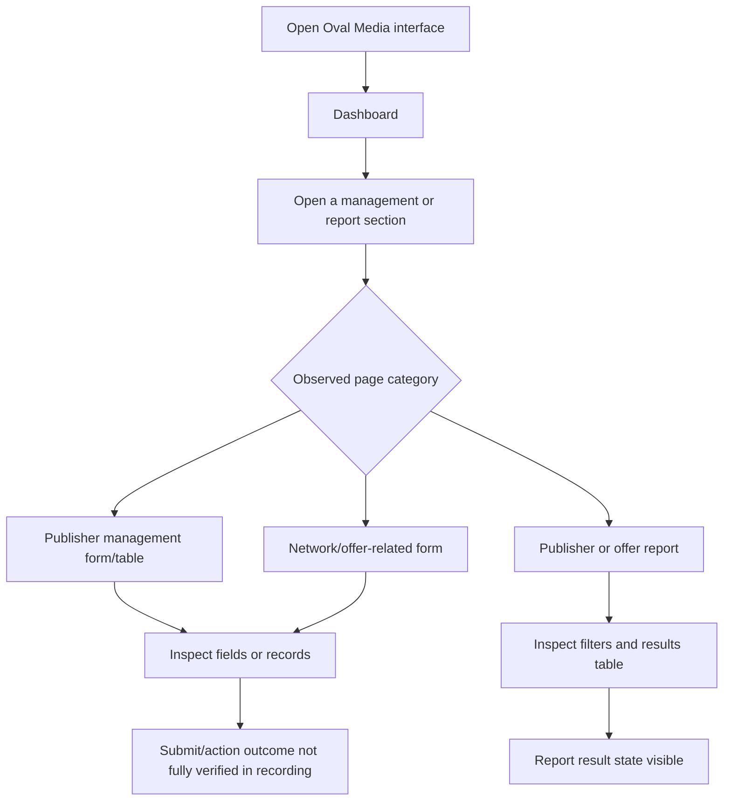

# Oval Media — Screen-by-Screen Software Requirements Specification

## 1. Evidence and scope

Source recording: `Max Wave & Oval Media.mov` (duration 00:08:48).
Application identification: Oval Media is identified from the visible application branding/interface during the walkthrough; the recording alternates between application contexts.
Evidence status: **video-observed** means visible in a sampled frame; it does not prove backend persistence or the result of an action. **Proposed** means a requirement for client approval, not a statement about the existing system.

## 2. Executive summary

The recording shows an administrative interface with a dashboard, publisher-related management views/forms, network/offer-related forms, and publisher/offer report views. The exact domain model and report calculations require confirmation.

## 3. Observed module inventory

- Dashboard
- Publisher Management
- Network Management (label partly uncertain)
- Offer Management (label partly uncertain)
- Publisher Report
- Offer Report

## 4. Screen inventory

| Screenshot ID | Screen / module | Timestamp | Evidence notes |
|---|---|---:|---|
| `OM-001_Dashboard` | Dashboard | 00:00:00 | Dashboard and left navigation visible; initial dashboard state. |
| `OM-002_Dashboard` | Dashboard | 00:00:39 | Return to Oval Media dashboard after switching browser context. |
| `OM-003_Publisher_Management` | Publisher Management | 00:01:30 | Form-like management screen with top-right green action button. |
| `OM-004_Publisher_Form` | Publisher Management | 00:01:51 | Publisher form with multiple fields and lower-page controls. |
| `OM-005_Publisher_Form_Options` | Publisher Management | 00:02:12 | Form state with visible dropdown/option interaction. |
| `OM-006_Publisher_Records` | Publisher Management | 00:02:33 | Management table with row-level colored action icons. |
| `OM-007_Network_Form` | Network Management | 00:03:00 | Network-related form page with top-right action button. |
| `OM-008_Offer_Form` | Offer Management | 00:03:18 | Offer-related form with multiple input fields and selected text. |
| `OM-009_Publisher_Report` | Publisher Report | 00:07:24 | Report page with filters and results table. |
| `OM-010_Offer_Report` | Offer Report | 00:07:54 | Offer report results table with multiple columns. |
| `OM-011_Publisher_Report_Later_State` | Publisher Report | 00:08:15 | Later report state; table and pagination/control area visible. |

## 5. Screen specifications

### OM-001_Dashboard — Dashboard

- **Application:** Oval Media
- **Module:** Dashboard
- **Screenshot:** `Screenshots/OM-001_Dashboard.png`
- **Source timestamp:** 00:00:00
- **Evidence status:** Observed frame; behavior partly observed / unresolved where noted.
- **Visible purpose:** Dashboard and left navigation visible; initial dashboard state.
- **Entry/navigation:** The recording shows this page/state. Exact click path and role gate are not fully established unless explicitly demonstrated.
- **Layout:** Preserve the visible header, navigation, page title, form/table arrangement, action controls and styling shown in the screenshot. Labels that are too small to read are not guessed.
- **UI controls:** Visible buttons, fields, navigation entries, tables and row actions should be inventoried during client-assisted field-level validation. This frame-level package does not claim every tiny label is legible.
- **Field specification:** Field names, types, required flags, defaults, validation and allowed values are **unconfirmed** unless separately documented by the client.
- **States/exceptions:** Only the sampled visible state is confirmed. Empty, loading, error, success, disabled and permission-denied states require additional evidence/tests.
- **Business rules/data model:** Not inferred from screen appearance. Obtain data dictionary, formulas and entity relationships from the client.
- **Acceptance criteria:** Given an authorized user and the approved requirements, when the user opens this page, then the page and its visible controls should render consistently with the approved screenshot. Action-specific criteria must be added after action outcomes are confirmed.
- **Open questions:** What exact fields/actions are present? What are required validations? What does each action do? What is persisted and where? Which roles can access the screen?

### OM-002_Dashboard — Dashboard

- **Application:** Oval Media
- **Module:** Dashboard
- **Screenshot:** `Screenshots/OM-002_Dashboard.png`
- **Source timestamp:** 00:00:39
- **Evidence status:** Observed frame; behavior partly observed / unresolved where noted.
- **Visible purpose:** Return to Oval Media dashboard after switching browser context.
- **Entry/navigation:** The recording shows this page/state. Exact click path and role gate are not fully established unless explicitly demonstrated.
- **Layout:** Preserve the visible header, navigation, page title, form/table arrangement, action controls and styling shown in the screenshot. Labels that are too small to read are not guessed.
- **UI controls:** Visible buttons, fields, navigation entries, tables and row actions should be inventoried during client-assisted field-level validation. This frame-level package does not claim every tiny label is legible.
- **Field specification:** Field names, types, required flags, defaults, validation and allowed values are **unconfirmed** unless separately documented by the client.
- **States/exceptions:** Only the sampled visible state is confirmed. Empty, loading, error, success, disabled and permission-denied states require additional evidence/tests.
- **Business rules/data model:** Not inferred from screen appearance. Obtain data dictionary, formulas and entity relationships from the client.
- **Acceptance criteria:** Given an authorized user and the approved requirements, when the user opens this page, then the page and its visible controls should render consistently with the approved screenshot. Action-specific criteria must be added after action outcomes are confirmed.
- **Open questions:** What exact fields/actions are present? What are required validations? What does each action do? What is persisted and where? Which roles can access the screen?

### OM-003_Publisher_Management — Publisher Management

- **Application:** Oval Media
- **Module:** Publisher Management
- **Screenshot:** `Screenshots/OM-003_Publisher_Management.png`
- **Source timestamp:** 00:01:30
- **Evidence status:** Observed frame; behavior partly observed / unresolved where noted.
- **Visible purpose:** Form-like management screen with top-right green action button.
- **Entry/navigation:** The recording shows this page/state. Exact click path and role gate are not fully established unless explicitly demonstrated.
- **Layout:** Preserve the visible header, navigation, page title, form/table arrangement, action controls and styling shown in the screenshot. Labels that are too small to read are not guessed.
- **UI controls:** Visible buttons, fields, navigation entries, tables and row actions should be inventoried during client-assisted field-level validation. This frame-level package does not claim every tiny label is legible.
- **Field specification:** Field names, types, required flags, defaults, validation and allowed values are **unconfirmed** unless separately documented by the client.
- **States/exceptions:** Only the sampled visible state is confirmed. Empty, loading, error, success, disabled and permission-denied states require additional evidence/tests.
- **Business rules/data model:** Not inferred from screen appearance. Obtain data dictionary, formulas and entity relationships from the client.
- **Acceptance criteria:** Given an authorized user and the approved requirements, when the user opens this page, then the page and its visible controls should render consistently with the approved screenshot. Action-specific criteria must be added after action outcomes are confirmed.
- **Open questions:** What exact fields/actions are present? What are required validations? What does each action do? What is persisted and where? Which roles can access the screen?

### OM-004_Publisher_Form — Publisher Management

- **Application:** Oval Media
- **Module:** Publisher Management
- **Screenshot:** `Screenshots/OM-004_Publisher_Form.png`
- **Source timestamp:** 00:01:51
- **Evidence status:** Observed frame; behavior partly observed / unresolved where noted.
- **Visible purpose:** Publisher form with multiple fields and lower-page controls.
- **Entry/navigation:** The recording shows this page/state. Exact click path and role gate are not fully established unless explicitly demonstrated.
- **Layout:** Preserve the visible header, navigation, page title, form/table arrangement, action controls and styling shown in the screenshot. Labels that are too small to read are not guessed.
- **UI controls:** Visible buttons, fields, navigation entries, tables and row actions should be inventoried during client-assisted field-level validation. This frame-level package does not claim every tiny label is legible.
- **Field specification:** Field names, types, required flags, defaults, validation and allowed values are **unconfirmed** unless separately documented by the client.
- **States/exceptions:** Only the sampled visible state is confirmed. Empty, loading, error, success, disabled and permission-denied states require additional evidence/tests.
- **Business rules/data model:** Not inferred from screen appearance. Obtain data dictionary, formulas and entity relationships from the client.
- **Acceptance criteria:** Given an authorized user and the approved requirements, when the user opens this page, then the page and its visible controls should render consistently with the approved screenshot. Action-specific criteria must be added after action outcomes are confirmed.
- **Open questions:** What exact fields/actions are present? What are required validations? What does each action do? What is persisted and where? Which roles can access the screen?

### OM-005_Publisher_Form_Options — Publisher Management

- **Application:** Oval Media
- **Module:** Publisher Management
- **Screenshot:** `Screenshots/OM-005_Publisher_Form_Options.png`
- **Source timestamp:** 00:02:12
- **Evidence status:** Observed frame; behavior partly observed / unresolved where noted.
- **Visible purpose:** Form state with visible dropdown/option interaction.
- **Entry/navigation:** The recording shows this page/state. Exact click path and role gate are not fully established unless explicitly demonstrated.
- **Layout:** Preserve the visible header, navigation, page title, form/table arrangement, action controls and styling shown in the screenshot. Labels that are too small to read are not guessed.
- **UI controls:** Visible buttons, fields, navigation entries, tables and row actions should be inventoried during client-assisted field-level validation. This frame-level package does not claim every tiny label is legible.
- **Field specification:** Field names, types, required flags, defaults, validation and allowed values are **unconfirmed** unless separately documented by the client.
- **States/exceptions:** Only the sampled visible state is confirmed. Empty, loading, error, success, disabled and permission-denied states require additional evidence/tests.
- **Business rules/data model:** Not inferred from screen appearance. Obtain data dictionary, formulas and entity relationships from the client.
- **Acceptance criteria:** Given an authorized user and the approved requirements, when the user opens this page, then the page and its visible controls should render consistently with the approved screenshot. Action-specific criteria must be added after action outcomes are confirmed.
- **Open questions:** What exact fields/actions are present? What are required validations? What does each action do? What is persisted and where? Which roles can access the screen?

### OM-006_Publisher_Records — Publisher Management

- **Application:** Oval Media
- **Module:** Publisher Management
- **Screenshot:** `Screenshots/OM-006_Publisher_Records.png`
- **Source timestamp:** 00:02:33
- **Evidence status:** Observed frame; behavior partly observed / unresolved where noted.
- **Visible purpose:** Management table with row-level colored action icons.
- **Entry/navigation:** The recording shows this page/state. Exact click path and role gate are not fully established unless explicitly demonstrated.
- **Layout:** Preserve the visible header, navigation, page title, form/table arrangement, action controls and styling shown in the screenshot. Labels that are too small to read are not guessed.
- **UI controls:** Visible buttons, fields, navigation entries, tables and row actions should be inventoried during client-assisted field-level validation. This frame-level package does not claim every tiny label is legible.
- **Field specification:** Field names, types, required flags, defaults, validation and allowed values are **unconfirmed** unless separately documented by the client.
- **States/exceptions:** Only the sampled visible state is confirmed. Empty, loading, error, success, disabled and permission-denied states require additional evidence/tests.
- **Business rules/data model:** Not inferred from screen appearance. Obtain data dictionary, formulas and entity relationships from the client.
- **Acceptance criteria:** Given an authorized user and the approved requirements, when the user opens this page, then the page and its visible controls should render consistently with the approved screenshot. Action-specific criteria must be added after action outcomes are confirmed.
- **Open questions:** What exact fields/actions are present? What are required validations? What does each action do? What is persisted and where? Which roles can access the screen?

### OM-007_Network_Form — Network Management

- **Application:** Oval Media
- **Module:** Network Management
- **Screenshot:** `Screenshots/OM-007_Network_Form.png`
- **Source timestamp:** 00:03:00
- **Evidence status:** Observed frame; behavior partly observed / unresolved where noted.
- **Visible purpose:** Network-related form page with top-right action button.
- **Entry/navigation:** The recording shows this page/state. Exact click path and role gate are not fully established unless explicitly demonstrated.
- **Layout:** Preserve the visible header, navigation, page title, form/table arrangement, action controls and styling shown in the screenshot. Labels that are too small to read are not guessed.
- **UI controls:** Visible buttons, fields, navigation entries, tables and row actions should be inventoried during client-assisted field-level validation. This frame-level package does not claim every tiny label is legible.
- **Field specification:** Field names, types, required flags, defaults, validation and allowed values are **unconfirmed** unless separately documented by the client.
- **States/exceptions:** Only the sampled visible state is confirmed. Empty, loading, error, success, disabled and permission-denied states require additional evidence/tests.
- **Business rules/data model:** Not inferred from screen appearance. Obtain data dictionary, formulas and entity relationships from the client.
- **Acceptance criteria:** Given an authorized user and the approved requirements, when the user opens this page, then the page and its visible controls should render consistently with the approved screenshot. Action-specific criteria must be added after action outcomes are confirmed.
- **Open questions:** What exact fields/actions are present? What are required validations? What does each action do? What is persisted and where? Which roles can access the screen?

### OM-008_Offer_Form — Offer Management

- **Application:** Oval Media
- **Module:** Offer Management
- **Screenshot:** `Screenshots/OM-008_Offer_Form.png`
- **Source timestamp:** 00:03:18
- **Evidence status:** Observed frame; behavior partly observed / unresolved where noted.
- **Visible purpose:** Offer-related form with multiple input fields and selected text.
- **Entry/navigation:** The recording shows this page/state. Exact click path and role gate are not fully established unless explicitly demonstrated.
- **Layout:** Preserve the visible header, navigation, page title, form/table arrangement, action controls and styling shown in the screenshot. Labels that are too small to read are not guessed.
- **UI controls:** Visible buttons, fields, navigation entries, tables and row actions should be inventoried during client-assisted field-level validation. This frame-level package does not claim every tiny label is legible.
- **Field specification:** Field names, types, required flags, defaults, validation and allowed values are **unconfirmed** unless separately documented by the client.
- **States/exceptions:** Only the sampled visible state is confirmed. Empty, loading, error, success, disabled and permission-denied states require additional evidence/tests.
- **Business rules/data model:** Not inferred from screen appearance. Obtain data dictionary, formulas and entity relationships from the client.
- **Acceptance criteria:** Given an authorized user and the approved requirements, when the user opens this page, then the page and its visible controls should render consistently with the approved screenshot. Action-specific criteria must be added after action outcomes are confirmed.
- **Open questions:** What exact fields/actions are present? What are required validations? What does each action do? What is persisted and where? Which roles can access the screen?

### OM-009_Publisher_Report — Publisher Report

- **Application:** Oval Media
- **Module:** Publisher Report
- **Screenshot:** `Screenshots/OM-009_Publisher_Report.png`
- **Source timestamp:** 00:07:24
- **Evidence status:** Observed frame; behavior partly observed / unresolved where noted.
- **Visible purpose:** Report page with filters and results table.
- **Entry/navigation:** The recording shows this page/state. Exact click path and role gate are not fully established unless explicitly demonstrated.
- **Layout:** Preserve the visible header, navigation, page title, form/table arrangement, action controls and styling shown in the screenshot. Labels that are too small to read are not guessed.
- **UI controls:** Visible buttons, fields, navigation entries, tables and row actions should be inventoried during client-assisted field-level validation. This frame-level package does not claim every tiny label is legible.
- **Field specification:** Field names, types, required flags, defaults, validation and allowed values are **unconfirmed** unless separately documented by the client.
- **States/exceptions:** Only the sampled visible state is confirmed. Empty, loading, error, success, disabled and permission-denied states require additional evidence/tests.
- **Business rules/data model:** Not inferred from screen appearance. Obtain data dictionary, formulas and entity relationships from the client.
- **Acceptance criteria:** Given an authorized user and the approved requirements, when the user opens this page, then the page and its visible controls should render consistently with the approved screenshot. Action-specific criteria must be added after action outcomes are confirmed.
- **Open questions:** What exact fields/actions are present? What are required validations? What does each action do? What is persisted and where? Which roles can access the screen?

### OM-010_Offer_Report — Offer Report

- **Application:** Oval Media
- **Module:** Offer Report
- **Screenshot:** `Screenshots/OM-010_Offer_Report.png`
- **Source timestamp:** 00:07:54
- **Evidence status:** Observed frame; behavior partly observed / unresolved where noted.
- **Visible purpose:** Offer report results table with multiple columns.
- **Entry/navigation:** The recording shows this page/state. Exact click path and role gate are not fully established unless explicitly demonstrated.
- **Layout:** Preserve the visible header, navigation, page title, form/table arrangement, action controls and styling shown in the screenshot. Labels that are too small to read are not guessed.
- **UI controls:** Visible buttons, fields, navigation entries, tables and row actions should be inventoried during client-assisted field-level validation. This frame-level package does not claim every tiny label is legible.
- **Field specification:** Field names, types, required flags, defaults, validation and allowed values are **unconfirmed** unless separately documented by the client.
- **States/exceptions:** Only the sampled visible state is confirmed. Empty, loading, error, success, disabled and permission-denied states require additional evidence/tests.
- **Business rules/data model:** Not inferred from screen appearance. Obtain data dictionary, formulas and entity relationships from the client.
- **Acceptance criteria:** Given an authorized user and the approved requirements, when the user opens this page, then the page and its visible controls should render consistently with the approved screenshot. Action-specific criteria must be added after action outcomes are confirmed.
- **Open questions:** What exact fields/actions are present? What are required validations? What does each action do? What is persisted and where? Which roles can access the screen?

### OM-011_Publisher_Report_Later_State — Publisher Report

- **Application:** Oval Media
- **Module:** Publisher Report
- **Screenshot:** `Screenshots/OM-011_Publisher_Report_Later_State.png`
- **Source timestamp:** 00:08:15
- **Evidence status:** Observed frame; behavior partly observed / unresolved where noted.
- **Visible purpose:** Later report state; table and pagination/control area visible.
- **Entry/navigation:** The recording shows this page/state. Exact click path and role gate are not fully established unless explicitly demonstrated.
- **Layout:** Preserve the visible header, navigation, page title, form/table arrangement, action controls and styling shown in the screenshot. Labels that are too small to read are not guessed.
- **UI controls:** Visible buttons, fields, navigation entries, tables and row actions should be inventoried during client-assisted field-level validation. This frame-level package does not claim every tiny label is legible.
- **Field specification:** Field names, types, required flags, defaults, validation and allowed values are **unconfirmed** unless separately documented by the client.
- **States/exceptions:** Only the sampled visible state is confirmed. Empty, loading, error, success, disabled and permission-denied states require additional evidence/tests.
- **Business rules/data model:** Not inferred from screen appearance. Obtain data dictionary, formulas and entity relationships from the client.
- **Acceptance criteria:** Given an authorized user and the approved requirements, when the user opens this page, then the page and its visible controls should render consistently with the approved screenshot. Action-specific criteria must be added after action outcomes are confirmed.
- **Open questions:** What exact fields/actions are present? What are required validations? What does each action do? What is persisted and where? Which roles can access the screen?

## 6. Functional requirements

| Requirement ID | Requirement | Trigger / expected behavior | Priority | Evidence/status | Test |
|---|---|---|---|---|---|
| OM-FR-001 | Display an administrative dashboard | Display an administrative dashboard (details of underlying behavior require client confirmation where noted) | Should | Dashboard visible in recording; Observed UI | OM-TC-001 |
| OM-FR-002 | Provide a Publisher Management view with form controls | Provide a Publisher Management view with form controls (details of underlying behavior require client confirmation where noted) | Should | Form-like screen and action button visible; Observed UI | OM-TC-002 |
| OM-FR-003 | Provide a publisher records table with row actions | Provide a publisher records table with row actions (details of underlying behavior require client confirmation where noted) | Should | Table and colored row actions visible; Observed UI | OM-TC-003 |
| OM-FR-004 | Provide a Network Management form/view | Provide a Network Management form/view (details of underlying behavior require client confirmation where noted) | Should | Network-related title/form visible; labels need verification; Partially observed | OM-TC-004 |
| OM-FR-005 | Provide an Offer-related form/view | Provide an Offer-related form/view (details of underlying behavior require client confirmation where noted) | Should | Offer-related title/form visible; labels need verification; Partially observed | OM-TC-005 |
| OM-FR-006 | Provide a Publisher Report view with filters/table | Provide a Publisher Report view with filters/table (details of underlying behavior require client confirmation where noted) | Should | Report heading, filters and table visible; Observed UI | OM-TC-006 |
| OM-FR-007 | Provide an Offer Report results view | Provide an Offer Report results view (details of underlying behavior require client confirmation where noted) | Should | Offer report and results table visible; Observed UI | OM-TC-007 |

## 7. Observed navigation/workflow

The diagram below summarizes observed page categories, not a verified click-by-click business transaction. Where the recording does not demonstrate a submission result, the outcome remains open.

## 8. UI/UX observations

- Administrative dashboard uses a dark blue/gray content area with a left navigation rail and a contrasting header.
- Green action buttons are visible on several management forms.
- Management pages include forms and data tables; some rows show multiple colored action icons.
- Report screens show filter areas and result tables.
- Keep the existing visual language distinct between applications unless the client approves a redesign.
- Responsive behavior, keyboard behavior, exact typography, color tokens and spacing have not been reliably measured from the recording.

## 9. Non-functional requirements (proposed, approval required)

- Define authentication, session policy, password recovery and MFA expectations.
- Provide a role/action permission matrix and enforce permissions server-side.
- Agree measurable performance targets for dashboard loading and report generation.
- Define data validation, transaction handling, logging/audit, backups, retention, privacy and recovery objectives.
- Agree browser/viewport support and accessibility target.
- Do not claim any compliance certification or SLA based on this video.

## 10. Technical architecture and integrations

The recording alone does not establish frontend framework, backend language, database schema, API endpoints, hosting, authentication provider, storage, queues, or integration contracts. These remain **unknown** pending technical discovery. Screens that suggest tracking, postbacks, affiliates or payouts may indicate integration-related behavior, but exact contracts and formulas must be supplied by the client.

## 11. Open questions

- **Q-001 — High priority:** What are the user roles and permission matrix? Impact: Could block authorization design and acceptance. Suggested next step: Provide roles, module access, action-level permissions and sample accounts.
- **Q-002 — High priority:** What does each Save/Create/Update/Delete action do, and what confirmation appears? Impact: Persistence and destructive-action behavior are not proven by screenshots. Suggested next step: Demonstrate successful and failed submissions; provide expected outcomes.
- **Q-003 — High priority:** Which fields are required, what are field types, defaults, allowed values and validation rules? Impact: Form implementation and test data depend on exact field rules. Suggested next step: Provide data dictionary or record a close-up walkthrough of every field and dropdown.
- **Q-005 — High priority:** What filters, columns, formulas, date boundaries, timezone and export options are supported? Impact: Report parity cannot be verified without report definitions. Suggested next step: Provide report samples and expected outputs for known input data.
- **Q-006 — High priority:** What APIs, third-party services, authentication schemes and webhook contracts are used? Impact: A recording does not expose integration contracts. Suggested next step: Supply API docs, credentials process, test endpoints and webhook examples.
- **Q-007 — High priority:** What are session timeout, MFA, password reset, audit log and account recovery rules? Impact: Security requirements are not observable in this walkthrough. Suggested next step: Provide security policy and compliance constraints.
- **Q-008 — Medium priority:** What browsers, viewport sizes, accessibility target and performance thresholds are required? Impact: Only one desktop recording is available. Suggested next step: Agree measurable compatibility, accessibility and response-time targets.
- **Q-009 — High priority:** What are retention, deletion, export, backup and recovery requirements? Impact: Data lifecycle and compliance cannot be established from the video. Suggested next step: Provide retention policy, RPO/RTO and data ownership rules.
- **Q-010 — High priority:** Are the observed systems to be replicated exactly, redesigned, or functionally modernized? Impact: Affects visual acceptance and implementation estimates. Suggested next step: Confirm pixel fidelity vs UX improvements and identify out-of-scope modules.
- **Q-011 — High priority:** Can the client provide credentials or a live sandbox for interaction-level verification? Impact: Video-only evidence limits validation of dropdowns, hidden states and persistence. Suggested next step: Provide read-only demo access or additional recordings of complete actions.

## 12. Implementation readiness

**Status: discovery required before implementation can be considered acceptance-ready.** The recording is useful for identifying visual page categories and building a first-pass screen inventory. Field-level specifications, action outcomes, domain rules, report calculations, permission rules, integrations and non-functional targets need confirmation before reliable estimation and implementation.
